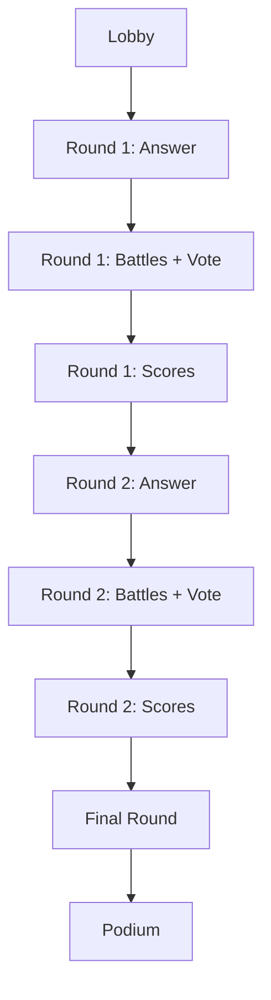

# OpenLash

OpenLash is an open-source party game inspired by Quiplash. One person hosts on a TV or laptop while everyone else joins on their phones. Players write funny answers to prompts, vote on the best quips, and compete for the top spot on the podium.

No accounts, no app store — just a room code and a browser.

## How to Play

1. On the **host display** (TV, projector, or laptop), open **Play Game** at `/host`.
2. Players open the **join URL** on their phones (shown on the host screen as a QR code and link).
3. Everyone enters the 4-character room code and a display name. Optional: draw or photograph an avatar.
4. The **VIP** (first player to join) taps **Everybody's In** when the lobby is ready.
5. Each round: answer prompts on your phone, then vote on head-to-head battles shown on the host screen.
6. After three rounds, scores are tallied and the winner is crowned on the podium.

### Roles

| Role | Where | What they do |
|------|-------|--------------|
| **Host display** | `/host` | Shows prompts, battles, scoreboard, and timer. Controlled by the VIP from their phone. |
| **Player** | `/play` | Writes answers and votes. Cannot vote on battles they are in. |
| **Audience** | `/play` (audience mode) | Votes only — no answering. Enabled in host settings. |
| **Moderator** | `/mod/:code` | Reviews flagged answers when moderation is on. Requires the mod password shown on the host screen. |

## Game Flow

OpenLash runs three scoring rounds, then a final round and podium.



### Rounds 1 and 2

- Each active player is paired into head-to-head **battles** (with a third player in triple-battles when the player count allows).
- Everyone receives prompts to answer within **40 seconds** (shorter in test mode).
- Battles play out one at a time on the host screen. Players vote for side A, B, C, or abstain within **20 seconds**.
- After each battle, answers are revealed and points are awarded.
- Round 1 max points per battle: **1,000**. Round 2: **2,000**.

### Final Round

The host picks one of two final modes in settings:

- **Thriplash** — Each player submits multiple answers. Battles run like earlier rounds but with higher stakes (up to **6,000** points per battle).
- **Last Lash** — One open-ended prompt. Everyone answers, then players distribute up to three votes across all answers. Points come from a shared **3,000**-point pool.

### Scoring Highlights

- **Jinx** — Two players submit the same answer (after normalization). Neither earns points.
- **Quiplash** — A player wins every non-audience vote while also winning the audience vote (requires at least 5 players). Bonus: 250 / 500 / 750 by round.
- **Super Quiplash** — Audience votes are ≥ 90% for the winner. Triggers a special reveal.
- **Winner bonus** — The battle winner receives an extra 10% of the round's max points.
- **Censor** — Players can censor their own quip before voting; censored answers forfeit.

## Features

- **Real-time multiplayer** over WebSockets (Socket.IO)
- **Up to 20 players** — 3–20 per game (default 20, set **Max players** in host settings); anyone past the limit joins as audience. Big games switch to a two-row answer screen and a two-column leaderboard
- **Custom prompt collections** — create, edit, and import prompt packs at `/collections`
- **Built-in prompt pack** seeded on first run
- **Bot fill** — test modes that fill the lobby with AI bots for solo development
- **Moderation queue** — optional mod password and review flow for mature content
- **Room password** — optional lobby lock
- **Pause / resume** — VIP can pause mid-game (not in lobby or on podium)
- **Reconnect** — players rejoin with the same token and keep their score
- **QR join** — scan the host QR code or room-code QR scanner on the play page
- **Screen checker** — `/screen-checker` helps calibrate the host layout for your display
- **Sound effects** — optional UI sounds (place `.wav` / `.mp3` files in a `sounds/` folder at the project root)

## Tech Stack

| Layer | Technology |
|-------|------------|
| Frontend | React 19, React Router, Vite |
| Backend | Node.js, Hono, Socket.IO |
| Database | SQLite (via `node:sqlite`) |
| Validation | Zod |
| Testing | Vitest (unit + integration), Playwright (E2E) |
| Deployment | Docker Compose (optional ngrok sidecar) |

## Project Structure

```
OpenLash/
├── src/
│   ├── game/           # Pure game logic — engine, pairing, scoring, bots
│   ├── shared/         # Types, constants, protocol schemas (client + server)
│   ├── server/         # HTTP API, WebSocket handlers, room management
│   ├── db/             # SQLite client, seed data, prompt collections
│   └── web/            # React UI (host, play, mod, collections)
├── tests/
│   ├── unit/           # Engine and utility tests
│   ├── integration/    # Socket + full-game tests (GameDriver)
│   ├── e2e/            # Playwright browser tests
│   └── helpers/        # GameDriver, e2eFlow shared setup
├── scripts/            # Docker LAN IP detection, ngrok entrypoint
├── config/             # ngrok configuration
├── docker-compose.yml
├── Dockerfile
└── vite.config.ts
```

Game rules live in `src/game/engine.ts` and are shared by the server and unit tests — the UI is a thin real-time client over Socket.IO events defined in `src/shared/protocol.ts`.

## Requirements

- **Node.js 22+**
- **npm**
- For Docker: **Docker** and **Docker Compose**
- For cross-network play without LAN: free [ngrok](https://ngrok.com) account and authtoken

## Quick Start (Development)

```bash
git clone https://github.com/Shaneciora/OpenLash.git
cd OpenLash
npm install
npm run dev
```

Open:

- **Home:** http://localhost:3000/
- **Host:** http://localhost:3000/host
- **Join:** http://localhost:3000/play

The dev server runs the backend with `tsx watch`. For frontend hot reload during UI work, run Vite separately:

```bash
# Terminal 1 — API + WebSocket
npm run dev

# Terminal 2 — Vite dev server (proxies /api and /socket.io)
npx vite
```

Then use http://localhost:5173 for the UI.

### LAN Play (Same Wi‑Fi)

Players must reach the host machine over the local network. Open the host page using your machine's **LAN IP**, not `localhost`:

```
http://192.168.x.x:3000/host
```

The join URL and QR code update automatically. If the join link still shows `localhost`, the server could not detect your LAN IP — set `PUBLIC_HOST` (see [Environment variables](#environment-variables)).

## Production Build

```bash
npm run build    # Vite client → dist/web, TypeScript server → dist/
npm start        # Serves everything on PORT (default 3000)
```

## Docker

Docker runs OpenLash with an optional ngrok tunnel for players outside your LAN.

```bash
# Optional: create .env with your ngrok token
echo "NGROK_AUTHTOKEN=your_token_here" >> .env

npm run docker:up
```

`docker:up` detects your LAN IP, writes it to the container environment, rebuilds the image, and starts services on **port 3000**. Persistent data (SQLite DB, collections) is stored in `./data`.

```bash
docker compose logs -f openlash   # follow server logs
docker compose down               # stop containers
```

### ngrok (Remote Players)

1. Sign up at [ngrok.com](https://ngrok.com) and copy your authtoken.
2. Add `NGROK_AUTHTOKEN=...` to `.env`.
3. Run `npm run docker:up`.
4. Open the ngrok dashboard at http://localhost:4040 to find the public HTTPS URL.
5. Share that URL + `/play` with remote players.

Without ngrok, everyone must be on the same network and use the LAN join URL.

## Environment Variables

| Variable | Default | Description |
|----------|---------|-------------|
| `PORT` | `3000` | HTTP / WebSocket port |
| `HOST` | `0.0.0.0` | Bind address |
| `DATA_DIR` | `./data` | Directory for SQLite database |
| `DB_PATH` | `$DATA_DIR/openlash.db` | SQLite file path |
| `PUBLIC_HOST` | auto-detected | LAN IP hostname for join URLs |
| `PUBLIC_URL` | — | Full public base URL (overrides LAN detection) |
| `NGROK_AUTHTOKEN` | — | Enables ngrok tunnel in Docker |
| `NGROK_API_URL` | `http://ngrok:4040` | ngrok local API (Docker internal) |
| `E2E_MODE` | — | Set to `1` for shorter timers in automated tests |

## Prompt Collections

Visit `/collections` to:

- Browse the default seeded collection
- Create new collections and add prompts
- Mark prompts as **regular** or **thriplash**
- Flag prompts as mature or US-centric

Host settings control the prompt source: built-in only, a specific collection, or mixed.

Seed the database manually:

```bash
npm run db:seed
```

## Testing

```bash
npm test                  # Vitest unit + integration
npm run test:unit         # Unit tests only
npm run test:integration  # Socket / GameDriver integration tests
npm run test:e2e          # Playwright browser tests
npm run test:ci           # Full CI suite (Vitest + Playwright in parallel)
```

E2E tests start their own server on port **3099** with `E2E_MODE=1` for faster timers.

A visual smoke test plays four full 20-player games (TV and laptop sizes, both final modes) and screenshots every screen. It is opt-in because it takes ~4 minutes:

```bash
SMOKE_20=1 SMOKE_DIR=./smoke-shots npx playwright test smoke-20
```

## API Overview

REST endpoints (Hono) under `/api/`:

| Endpoint | Description |
|----------|-------------|
| `GET /api/health` | Health check |
| `GET /api/join-base` | Resolve play join URL (LAN / ngrok / public) |
| `GET/POST /api/collections` | List or create prompt collections |
| `GET/PUT/DELETE /api/collections/:id` | Manage a collection and its prompts |

Real-time game actions use **Socket.IO** on `/socket.io`. Event names and Zod payloads are in `src/shared/protocol.ts`.

## Architecture

```
┌─────────────┐     WebSocket      ┌──────────────┐
│  Play phone │ ◄────────────────► │              │
└─────────────┘                    │  Node server │
┌─────────────┐     WebSocket      │  (Hono +     │
│  Host TV    │ ◄────────────────► │   Socket.IO) │
└─────────────┘                    │              │
                                   │  ┌────────┐  │
                                   │  │ Engine │  │  ← pure game logic
                                   │  └────────┘  │
                                   │  ┌────────┐  │
                                   │  │ SQLite │  │  ← prompts / collections
                                   │  └────────┘  │
                                   └──────────────┘
```

- **Rooms** are in-memory on the server; each room has a 4-character code.
- **State snapshots** are broadcast to all clients in a room on every change.
- **Timers** run server-side; clients display countdown rings synced to `phaseEndsAt`.
- The **VIP** is the first connected player and controls start, pause, kick, and settings.

## License

This project is open source. See the repository for license details.

## Acknowledgments

Inspired by [Quiplash](https://www.jackboxgames.com/) from Jackbox Games. OpenLash is an independent, open-source implementation and is not affiliated with or endorsed by Jackbox Games.
